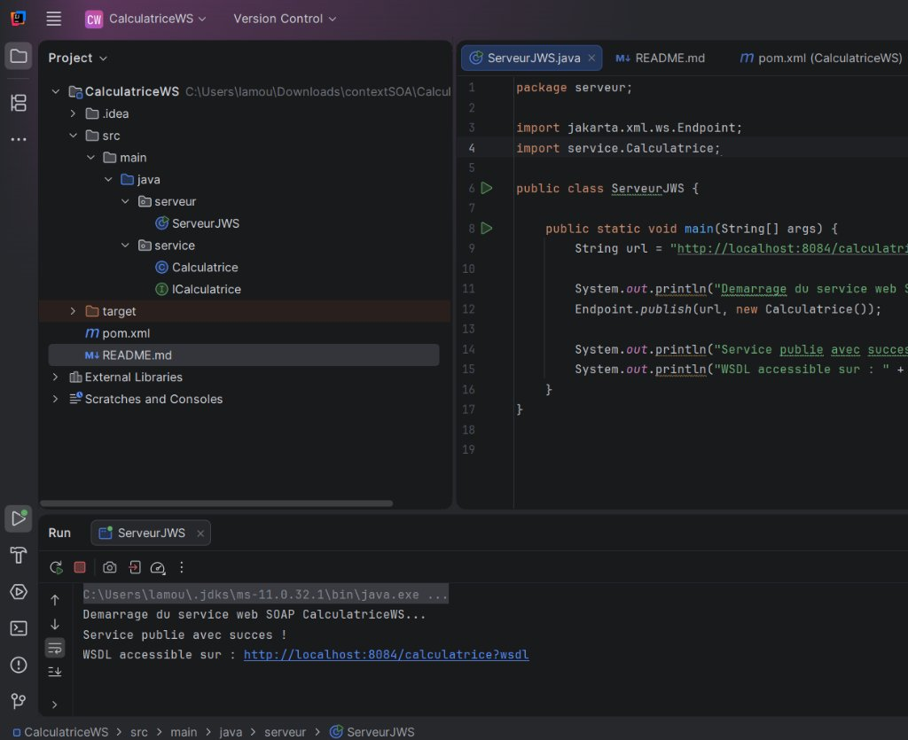
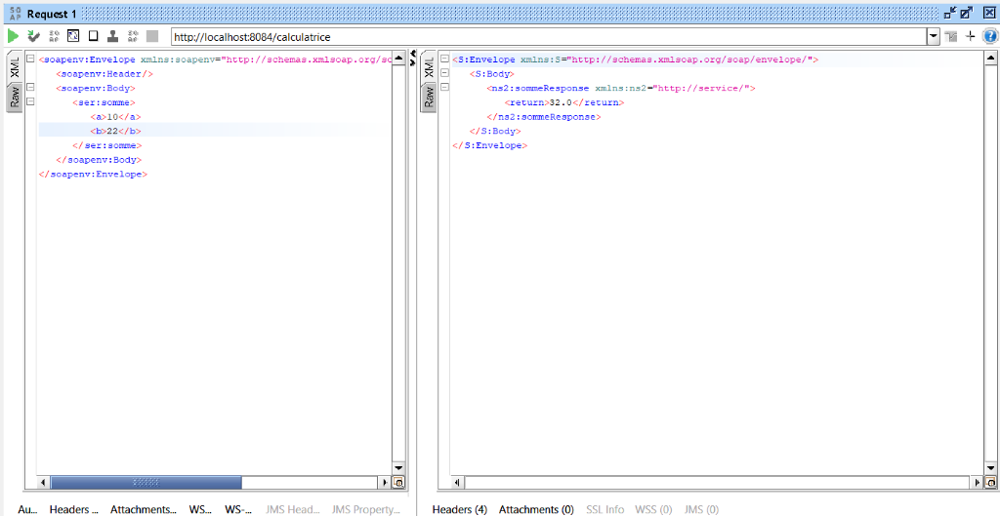

# TP2 — Mise en œuvre de Jakarta XML Web Services (SOAP)

**Réalisé par :** Yassine Lamouchi  
**Groupe :** LSI3 2.1  
**Matière :** Architecture SOA et Services Web  
**Année Universitaire :** 2026-2027  
**Faculté des Sciences de Sfax — Département d'Informatique et des Communications**

---

## Description

Ce projet implémente un **service web SOAP** nommé **CalculatriceWS** en utilisant **Jakarta XML Web Services (JAX-WS)**.  
Le service expose quatre opérations arithmétiques (somme, soustraction, multiplication, division) via le protocole SOAP, testables avec SoapUI.

---

## Structure du projet

```
TP2-SOA/
├── pom.xml                                  # Fichier de configuration Maven (dépendances JAX-WS)
├── README.md                                # Documentation du projet
├── screenshots/                             # Captures d'écran de l'exécution et des tests
│   ├── console_serveur.png                  # Console IntelliJ lors du démarrage du serveur
│   └── test_soapui.png                      # Exécution et réponse du test dans SoapUI
└── src/
    └── main/
        └── java/
            ├── service/                     # Package contenant l'interface et l'implémentation du service
            │   ├── ICalculatrice.java       # Interface annotée @WebService (contrat du service)
            │   └── Calculatrice.java        # Implémentation des 4 opérations arithmétiques
            └── serveur/                     # Package contenant le serveur de publication
                └── ServeurJWS.java          # Point d'entrée : publie le service via Endpoint.publish()
```

### Détail des fichiers et dossiers

| Fichier / Dossier    | Rôle                                                                                      |
| :------------------- | :---------------------------------------------------------------------------------------- |
| `pom.xml`            | Déclare les dépendances Maven : `jakarta.xml.ws-api`, `jaxws-rt`, `jakarta.jws-api`       |
| `screenshots/`       | Dossier contenant les captures d'écran démontrant la bonne exécution du projet            |
| `ICalculatrice.java` | Interface du service annotée avec `@WebService`, `@WebMethod`, `@WebParam`                |
| `Calculatrice.java`  | Classe métier implémentant les opérations : somme, soustraction, multiplication, division |
| `ServeurJWS.java`    | Classe main qui publie le service sur `http://localhost:8084/calculatrice`                |

---

## Prérequis

- **JDK 11** (ou supérieur)
- **IntelliJ IDEA** (Community ou Ultimate)
- **SoapUI** (pour les tests des requêtes SOAP)

---

## Exécution du projet dans IntelliJ IDEA

### 1. Importer le projet

1. Ouvrir IntelliJ IDEA
2. **File → Open** → sélectionner le dossier `TP2-SOA`
3. IntelliJ détecte automatiquement le `pom.xml` et importe les dépendances Maven

### 2. Lancer le serveur

1. Ouvrir la classe `serveur/ServeurJWS.java`
2. Clic droit → **Run 'ServeurJWS.main()'**
3. La console affiche les messages de confirmation :
   ```
   Demarrage du service web SOAP CalculatriceWS...
   Service publie avec succes !
   WSDL accessible sur : http://localhost:8084/calculatrice?wsdl
   ```

> **Capture d'écran de la console IntelliJ lors du lancement du serveur :**



### 3. Vérifier le WSDL

Ouvrir dans un navigateur web l'URL suivante pour inspecter le contrat WSDL généré dynamiquement :  
👉 [http://localhost:8084/calculatrice?wsdl](http://localhost:8084/calculatrice?wsdl)

### 4. Tester avec SoapUI

1. Lancer SoapUI → **File → New SOAP Project**
2. Saisir l'URL du WSDL : `http://localhost:8084/calculatrice?wsdl`
3. Ouvrir la requête générée pour l'opération `somme` et renseigner les valeurs (ex: `a = 10` et `b = 22`)
4. Cliquer sur le bouton vert **Play** pour exécuter la requête SOAP

> **Capture d'écran du test SoapUI (Requête et Réponse SOAP) :**



---

## Exemple de requête/réponse SOAP (Opération `somme`)

### Requête SOAP envoyée

```xml
<soapenv:Envelope xmlns:soapenv="http://schemas.xmlsoap.org/soap/envelope/"
                  xmlns:ser="http://service/">
   <soapenv:Header/>
   <soapenv:Body>
      <ser:somme>
         <a>10</a>
         <b>22</b>
      </ser:somme>
   </soapenv:Body>
</soapenv:Envelope>
```

### Réponse SOAP reçue

```xml
<S:Envelope xmlns:S="http://schemas.xmlsoap.org/soap/envelope/">
   <S:Header/>
   <S:Body>
      <ns2:sommeResponse xmlns:ns2="http://service/">
         <return>32.0</return>
      </ns2:sommeResponse>
   </S:Body>
</S:Envelope>
```

---

## Technologies utilisées

- **Jakarta XML Web Services (JAX-WS)** — API et annotations pour les services web SOAP
- **Maven** — Gestion des dépendances et du cycle de vie du projet
- **Java 11** — Langage de développement
- **SoapUI** — Outil de test des requêtes et réponses SOAP
